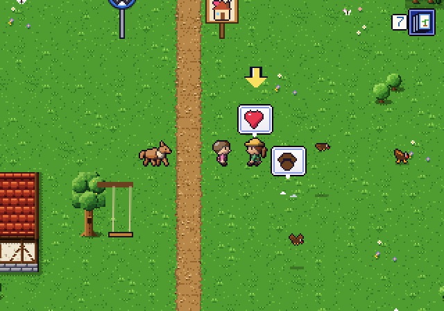
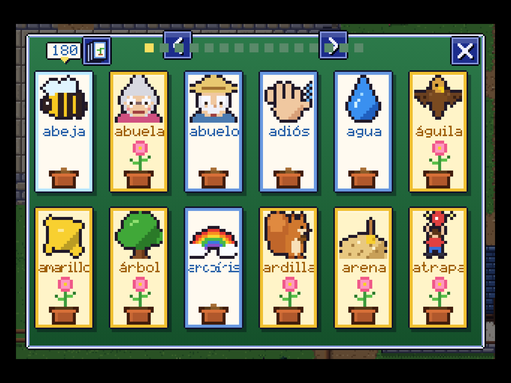

# Audit, October 2026: where the game stands

*Written 2026-10-21 on branch `claude/zen-sagan-mr8xwf` (the live game is `main`), and revised the same day after two
independent reviews re-checked its numbers. This is the check-up before any new content gets built. The answers to
"where should this end up after three years, and how much content will that take" are in `docs/ROADMAP_3_YEARS.md`.
This file covers the state of the game today and the polish to do first.*

**What went into it:** six audits (learning, a child's-eye run through the open world, technical health, the Spanish,
look/sound/feel, and how much content there is), two research reports (realistic Spanish targets for a child; how the
game should grow from age 7 to 10) and a 3-year learning simulation. The surprising claims were re-checked against the
code; the line numbers below are current.

**How it was measured:** bots that play like a child did the playing. They only tap what is on screen, pick a wrong
card first 12% of the time and say 35% of their answers aloud, and a 7-year-old's reading and thinking time is added
on top. Screens were iPad-sized (1024x768, touch). Two kinds of run were used, and the tables say which:
- **Live settings** (warm-up, phrases and listen-and-do **on**, as in the live game): the open-world learning run, the
  child's-eye run and the five zone runs.
- **Test settings** (those three features **off**, the test harness's default): the vocabulary audit of Villa Sol's
  story and the content audit's Villa Sol run. Their rows are marked *(features off)*. The warm-up's time was added
  to the content totals afterwards.

Timings marked "4x" come from a desktop browser (Chromium) slowed to a quarter of its speed to stand in for an older
iPad, on a shared machine. They are rough and have not been checked on her iPad or in Safari.

**Evidence:** the key screenshots, the six audits' findings, the research reports and the simulation's output are in
`docs/audit-2026-10/` (shortened to `evidence/` below). The simulation itself is `tools/sim-3year.js`. Logs and
scripts not copied there are in a temporary scratch folder and will disappear.

---

## 1. The short version

- **Keep what's working.** The child loves the dog, the album, exploring and hide-and-seek, and those parts are
  solid. The hand-written Spanish reads clean (in an AI read-through; a native speaker hasn't checked it yet), the
  learning engine is carefully designed, saves survive bad data, and the last full test run passed all of its ~1,630
  checks.
- **Five problem areas need fixing before any new content.** They come down to about 28 "gate" items, listed in
  section 5:
  1. **The guide arrow traps a child who follows it.** A child who picks "¡A explorar!" at the start is sent in and
     out of the front door within the first minute. On her first zone visit, once she has met 3 album animals,
     Lola's bubble repeats the same greeting about 45 times. A third bug hides the zone stories from children who
     chose to explore first. (Measured with bots that follow the arrow; a child who wanders off may break out.) The
     old complaint "didn't know what to do next" is back on the live game.
  2. **Three years of progress sit in a single Safari storage box with no backup.** Safari deletes it after 7 days of
     Safari use without a visit, and when saving fails nobody is told. The fix has to ship before the winter break.
  3. **The memory engine can't carry three years.** Its longest review gap is 8 days, so it can keep only about
     190-370 items properly on schedule. Under the 3-year simulation, well-learned words survive being skipped, so it
     would still hold about 930 items at a slow 1.5 new items a day, but far fewer stay durable, and it collapses when
     new words come faster: at today's measured pace of about 5 a day, only about 3% of what she meets would be kept
     after three years. Nothing paces new words in the open world, words are marked learned too soon, she rarely
     says a word from memory, and the parents' "retention" number can't see forgetting.
  4. **Some Spanish lines built by code teach the wrong gender** ("¿Y para el cabra?", "¿Y el rana?"). One beach line
     uses "¡Qué caliente!" about a person. In Mexico that has a sexual meaning; it should be "¡Qué calor!".
  5. **The engine slows down as content grows.** Today's zone maps run at 21-29 frames a second in the slowed
     desktop test. In the same test, three times today's content gave about 2 frames a second.
- **Content runs out early.** A real child gets about 7 hours of first-time play (range 6-10; 4.8 hours at the bots'
  pace). That is 4-6 weeks of daily play, or 6-10 weeks at 4-5 days a week: 2-4% of three years. The story scenes
  themselves are only about 2 of those hours; the rest is walking, side quests, favours, finds and the album. The
  roadmap works out how much more is needed.
- **Timeline.** The gate is roughly 6-9 weeks of work (section 5). Sprint 1 should reach the live game in small
  weekly releases, the fixes she will notice first.

---

## 2. Measured numbers

### Content
| What | Measured | Note |
| --- | --- | --- |
| First-time content (everything new to see and do) | **4.8-5 hours** at the bots' child pace; **about 7.4 hours for a real child** (range 6-10) | Villa Sol story 157 min *(features off)* + 5 zones 107 min + warm-ups and album taps (bot minutes). A real child takes 1.25-2 times the bot's time |
| Of which: the story scenes themselves | **about 1.7-2 hours** for all 36 chapters (child's-eye run) | A Villa Sol chapter's scenes take about 2.7 child-minutes, a zone's three chapters about 9. The content audit's "chapter windows" (about 7.5 child-minutes each) also count the walking, finds and side play around each chapter |
| Sessions until it's all used up | 27-44 sessions of 15 min (central 33) | **4-6 weeks of daily play; 6-10 weeks at 4-5 days a week.** Villa Sol alone takes at least 12 days, because some chapters wait for "tomorrow". The story scenes alone could be finished in 2-4 weeks |
| Share of three years | 2-4% | Three years every day = 1,095 sessions, 274 hours |
| Repeatable activities each day | 50-60 minutes available | Always the same ~30 kinds of activity over the same 180 words |
| Inventory | 180 words, 6 phrase patterns, 36 chapters (21 Villa Sol + 3 per zone), 50 album animals (not 55), 26 notebook pages, 43 hiding places, 27 friends with hearts, 36 favour offers, ~25 zone side quests, 15 dog spots, 9 listen-and-do boards | Friendship hearts fill up in 3-4 days per zone |
| Reachable at 15 minutes a day | 174 of 180 words; 45 of 50 animals | 6 words and 5 night animals appear only after 18 minutes of play in one sitting |
| Met by following only the arrow | 83 of 107 zone words; 16 of 39 zone animals | The rest depend on her curiosity (tapping animals herself, mornings, sunshine) |

### Practice (how much Spanish happens per minute)
| What | Measured | Target |
| --- | --- | --- |
| Villa Sol story, active answers per minute *(features off)* | **about 5.0** (80-90 prompts in 15 min) | High: good |
| Open world, practice moments per minute (live settings) | **1.6** overall (about a quarter of the time); 3.8 on day 1, then **0.5-0.6** on the forest days | 3 or more (about half the session) |
| Share of a guide-following child's time spent in dialogue and questions | **85-94%**; about 7 questions a minute; one talk had 10 pages and 11 questions | At most 3 questions before something happens on the map |
| New words in one 15-minute session | up to **20** (open world, live settings); 12-14 (story, *features off*) | 4-6, cap 8 (`docs/LEARNING_RESEARCH.md` R2) |
| Old words reviewed per day while exploring | 6-7 (days 4-6) | That run's own due list at the end of days 4-6: **12, 18 and 25**, so reviews fell further behind each day |
| A place's words used once she has left it | 1, 0 and 2 uses a day for 14 beach words | Every few days |
| Listen-and-do requests, beach-first child | **0 in 6 days** | Some every day |

### The learning engine
| What | Measured |
| --- | --- |
| Longest review gap | 8 days (`src/words.js:61`) |
| Reviews falling due per day, if every answer is right (a best case) | 22.5 at 180 words; at 1,000 words met over 3 years: **24 / 70 / 114** in years 1 / 2 / 3 (125 once steady); with gaps up to 150 days, 5.6 / 8.2 / 9.7 |
| Reviews a day **with real forgetting** (the 3-year simulation; fixed engine, review-first pacing, about 1,000 items in year 2) | **about 25-30 done a day**; see the roadmap's section 2.4 for how these numbers fit together |
| Time from meeting a word to "gold" (remembered) *(features off)* | median **115 seconds** |
| Words marked "solid" | **73 of 73** at the end of the Villa Sol run *(features off)*; 18 of 23 after 4 days of exploring (live settings), at a median of 3 uses each |
| Retention shown to parents | 88% in the open-world run, although the median word had been used only 3 times |
| Chance of being marked right by pure guessing | 33% (3 cards), 52% (page puzzle), 50-54% (listen trays), 100% (phrase builder) |

### Speed, storage and tests
| What | Measured | Note |
| --- | --- | --- |
| Zone maps at 4x slowdown | **20.6-28.9 frames a second**: about 30-42 ms of work per frame on average, up to about 62 ms (95th percentile) | 60 is smooth (16 ms a frame). The barn runs at 52 fps; the title at 60 |
| Same, on a normal desktop | 6-10 ms a frame | Fine today |
| With a simple per-frame memo (the program remembers answers within a frame instead of re-working them) | **2.3-2.8 times faster** on the zone maps at 4x (12.5-15.9 ms a frame); 1.85 times in Villa Sol (19.5 ms); up to 3.7 times without the slowdown | Measured in a scratch copy |
| With 3x today's chapters and hiding places (synthetic test) | **500 ms a frame at 4x** (about 2 fps); 97 ms on a normal desktop | 36 ms with the memo. Not measured on an iPad |
| Download | 2.11 MB (624 KB compressed); the Spanish content is about 580 KB of it | Title appears in ~0.2 s from file, ~0.75 s on wifi, ~2 s on cold 4G |
| Save size per player | 29,000 characters at day 10, **131,000 at day 90** | About 460 characters per word + 45,000. 1,000 words ≈ 0.5 million characters per player. Safari may count 2 bytes per character, so its ~5 MB limit could mean only ~2.6 million characters: to be measured on her iPad |
| Time to save | 0.4 ms (180 words); 4.6 ms (2,000 words); 25 ms at 4x | Done after every answer |
| Automated tests | ~1,630 checks in 31 files, all passing at the last full run (DEVLOG, 2026-10-21). This audit re-ran 7 of the files (about 34 minutes): all passed, 0 console errors | Run one after another, and the run stops at the first failure |
| Test run time | full playthrough test **28 minutes**; the whole suite estimated at **2+ hours** (not timed end to end) | No automatic test runs on GitHub (no CI) |

### Spanish, screen and sound
| What | Measured |
| --- | --- |
| Spanish strings read line by line | 2,084, plus 429 Spanish/English pairs. **An AI read-through, not yet checked by a native speaker** |
| Missing accents; wrong usted/vosotros | **0**; **0** |
| Listen-and-do sentences generated | 646 different ones, grammatical apart from the personal *a* with animals ("Toca el perro" should be "Toca al perro"); a few odd in meaning ("Dame el sol pequeño") |
| Wrong lines built by code (wrong article or agreement) | **37 different wrong outputs** in 5 places (favours 9; Lola's favourite animal 21 of 50 animals; Mateo 5 of 5; Simón dice 1; the finale 1) |
| Word-card labels squeezed sideways | **75 of 180** (42%); 33 of them below 80% of their width and 6 below half. The deck screenshot shows letters already breaking up at about 80% ("amarillc", "arcoíris") |
| Album names wider than their box | 3 of 50, plus 1 borderline (luciérnaga, 69 px in a 70 px box) |
| On the iPad | game shown 3x, buttons 60 points: good touch size |
| Phone held upright | game fills 22% of the screen, text 7 px tall, buttons 20 px |
| Music | 7 loops (all from the earlier RPG) shared by 21 maps. **4 maps use a 2.7-second jingle as their music and are silent within about 6.5 s of entering** |

---

## 3. Strengths to keep

| Strength | Evidence |
| --- | --- |
| **The dog, the album (Pokédex), exploring, hide-and-seek** are what she loves | Playtests 2026-10-09 and 10-11 (`docs/PLAYTEST_NOTES.md`) |
| **The guide arrow works when it isn't stuck in a loop** | Day 2: chapters 3-6 with 0 seconds lost. The whole grandparents' story finished from arrows alone. Town to the first zone in 9 s; a bus ride 3.9 s |
| **A carefully designed learning engine** | One unknown word at a time; follow-ups at 1.5 and 6 minutes; review boxes; a day-by-day history in the save; the dog's warm-up; phrases; listen-and-do. Story play gives about 5 answers a minute |
| **Correct, Mexican, child-appropriate Spanish where it is hand-written** | 0 accent slips in about 2,000 lines (AI read-through); tú used throughout; boy and girl forms handled; good Mexican choices (papalote, resbaladilla, catarina, chamarra, jitomate, elote, tlacuache, ¡Ahorita!) |
| **The request maker** | 646 different listen-and-do sentences with correct agreement, plurals and *un/una*; the only grammar slip is the personal *a* with animals (L4) |
| **Never stuck, never forced** | Listen-and-do and carry requests always finish, even for a child who doesn't understand. Nothing is locked. Questions never have more than 4 choices |
| **Kind design** | No streaks, no "we missed you", no stars shown, no daily caps, no time pressure. Research on children's apps finds manipulative design common; this game has none |
| **Touch-first on iPad** | 60-point buttons, tap to walk, the deck in the corner; a ghost hand shows each new kind of action once |
| **Speaking that degrades gracefully** | iPad mic quirks are handled; the mic test can share its log; tapping always works |
| **Robust saves** | 12 malformed or old saves all opened cleanly |
| **Healthy code basics** | No console errors in any run; fast start; memory use 4-15 MB; the single-file build matches the sources |
| **Charm** | A consistent 16-bit look, a readable pixel font, the snow zone, the weather, the sunset over Villa Sol, the night "Hoy" card |

---

## 4. Ranked issues (all six audits merged)

**Severity:** *Critical* = breaks play for most children, loses her progress, or blocks the 3-year plan. *High* =
she sees it often, or it makes the learning untrue. *Medium* = noticeable, with a clear fix. *Low* = small.
"Fix in" points to the polish plan in section 5. Each issue starts with a plain sentence; the evidence column keeps
the code references for whoever fixes it.

*C2: on the first zone visit the arrow stays on Lola, and each tap replays the same four lines.*

### Critical
| # | Issue | Evidence | Fix in |
| --- | --- | --- | --- |
| C1 | **Choosing "¡A explorar!" at the start traps a child who follows the arrow in an in-and-out loop at the front door.** Following the arrow gave 49 door trips in 60 s | `src/guide.js:143` (the "job in casa" goal), `src/chapters.js:398-402`; the test at `tools/test-world.js:50` is too loose to catch it; `evidence/shots/01a_…`, `01c_explore_loop_town_arrow.png` | 1.1 |
| C2 | **Lola's bubble repeats the same 4-line greeting about 45 times (about 4 minutes) on the first zone visit**, once she has met 3 album animals, and the arrow never leads into the zone's story | Her bubble shows whenever 3 album animals are met (`src/phrases.js:704`), but her talk (`:640-643`) asks for a phrase that can't be introduced within 240 s of another one (`P.GAP`, `:53`, checked at `:350`), so it falls back to her hello; `evidence/shots/02_lola_heart_bubble_loop.png` | 1.2 |
| C3 | **After "go explore", the arrow never points to a zone's next chapter** until the puppy chapter is played. In the measured runs the forest's story never started in 3 days, the grandparents' stopped after chapter 1, and the park's first day ran 13.7 minutes without it starting | `src/guide.js:158-160` (puppyLater applies in every place, not just Villa Sol) | 1.3 |
| C4 | **Her progress lives only in Safari storage**: no backup, no export, no "please keep" request, and a failed save is silent (stars were 37 in the game and 0 in storage). Her iPad and Windows games are separate saves with no way to move between them | `src/state.js:90-166`, `src/core.js:240`; no `navigator.storage.persist` anywhere. Safari deletes site storage after 7 days of Safari use without a visit; "Clear History" wipes it too | 1.7 |
| C5 | **The longest review gap is 8 days**, so the daily review load grows with every word: even if she never forgot, 22 a day at 180 words and 114 a day at 1,000 | `src/words.js:61` `BOX_DAYS=[0,0,1,2,4,8]`, `:228` caps at box 5 | 2.1 |
| C6 | **Once she leaves a place, its words are hardly reviewed.** Beach words got 1, 0 and 2 uses a day while she was in the forest and park. A design rule keeps each zone to its own words | `docs/WORLD_PLAN.md:411` "Never require another zone"; the warm-up carries only 2-3 words (`src/warmup.js`); `evidence/audits/learning.json` | 2.5 |
| C7 | **Nothing paces new words in the open world, and nothing puts review before new words.** 20 new words in one session; the 3-year simulation shows that without "review first" pacing, new words outrun reviews and most are lost | `src/words.js:298` `B.OPEN = true`; the roadmap, section 2.2 | 2.9 |
| C8 | **The engine's cost per frame grows faster than the content.** Maps run at 21-29 fps at 4x today; 3x the content gave about 2 fps in the same test | Chapters and hiding places are looked up from scratch thousands of times a frame (`src/chapters.js:61-96`, `src/seek.js:71-72`); `evidence/audits/tech.json` | 4.1 |
| C9 | **First-time content runs out in 4-6 weeks of daily play** (2-4% of three years) | `evidence/audits/content-time.json` | The roadmap |

### High
| # | Issue | Evidence | Fix in |
| --- | --- | --- | --- |
| H1 | **She rarely has to pull a word out of memory and say it.** Almost every "say it" shows the written word on a card, or comes just after hearing it, so "said aloud" mostly means "read aloud". The album only plays names and never asks for one | `src/warmup.js:189`, `src/learn.js` Choice; `evidence/shots/evidence_warmup_bigmic_with_written_cards.png` | 2.6 |
| H2 | **Words are marked learned too soon.** Gold comes a median of 115 s after meeting; "solid" comes after any one right tap the next day | `src/words.js:213-221`; all 73 met words solid at the end of the run | 2.3 |
| H3 | **The parents' "retention" figure counts formats that can be guessed or can't be failed**, so 70-80% says little about memory and nothing about recall | `src/history.js:136-146`; the phrase builder is always right (`src/phrases.js:202`) | 2.8 |
| H4 | **A forgotten word gets its place back after one right answer 60 s later** (just after being shown the answer) | `src/words.js:241` then `:224-228` | 2.2 |
| H5 | **Lines built by code use the wrong article**: "¡para la parque!", "¿Y el cabra? ¡Búscalo!", "¿Y para el cabra?" (the finale, seen by every player), "¡El tortuga!" (21 of 50 animals), "¡Me encanta nieve!", "toca tu ojos" | `src/favores.js:128-135, 171-172`; `content/es/story-c11-c21.js:1052`; `src/phrases.js:647`; `content/es/zone-montana.js:331`; `content/es/zone-abuelos.js:492` | 1.9 |
| H6 | **"¡Uf! ¡Qué caliente!" said by a person who feels hot.** In Mexico, *caliente* about a person is sexual; the phrase is "¡Qué calor!" | `content/es/zone-playa.js:344` and `:338` | 1.9 |
| H7 | **One error anywhere in a talk freezes the map for good; one error in a screen stops the whole game.** Errors only go to a console nobody sees on an iPad | `src/field.js:95, 110, 114-115` (no clean-up); `src/core.js:228-234` (loop not protected). Both reproduced | 1.8 |
| H8 | **Story scenes are mostly quizzes**: 85-94% of a guide-following child's time is dialogue and questions, about 7 a minute; chapter 20 asks 8 in a row, and one talk (Don Pepe's) has 10 pages and 11 questions | `evidence/audits/childs-eye.json`; `content/es/story-c11-c21.js:961-1003` | 3.1 |
| H9 | **Free play has little language**: 1.6 practice moments a minute in the open world, 0.5-0.6 on the forest days. The 3-year plan assumes about 3 a minute | `evidence/audits/learning.json`; the roadmap, section 1.4 | 3.2 |
| H10 | **At the grandparents' place the bus stop sits under the menu button.** Tapping where the arrow points opens the menu | `content/es/zone-abuelos.js:1059` (stop at the top-right); `evidence/shots/03b_tap_on_bus_opens_menu.png`, `03c_arrow_points_at_menu_button.png` | 1.4 |
| H11 | **The farm, Rosa's house, the bakery and the whole grandparents' zone fall silent**: a 2.7-second jingle is used as their music, so they are silent within about 6.5 s of entering | `src/maps.js:190, 239, 247`; `content/es/zone-abuelos.js:736` (`music: 'inn'`) | 1.10 |
| H12 | **Word-card labels are squeezed sideways until they break up**: 75 of 180 labels are squeezed, and letters already garble at about 80% width ("amarillc", "arcoíris"; "buenas noches" on the bedtime card). 3 long album names spill into the next box | `src/cards.js:215`, `src/album.js:170`; `evidence/shots/s_deck.png`, `s_evening_2_TodayCard.png`, `s_album_playa.png` | 3.3 |
| H13 | **A 15-minute child never sees sunset, bed or the "¡Hoy!" recap**; the night animals and words can't be reached. The recap counts only the current sitting | `src/day.js:12` (18 minutes); `evidence/shots/05_hoy_card_empty_after_reopen.png` | 1.11 |
| H14 | **Music: 7 RPG loops cover 21 maps and restart from the first bar after every door and reward jingle.** The beach plays a minor-key cutscene theme; the playground plays the title song | `src/audio.js:174, 209`; 79 places play jingles | 3.4 |
| H15 | **Built by layering**: 36 wrapper layers over 22 functions, in an order set by 56 script tags. Each new zone adds more. "Who answered this tap?" means reading 7 files | e.g. `G.animals.tapped` wrapped 7 times; `evidence/audits/tech.json` | 4.2 |

*H12: the deck on the iPad. Bottom row: "amarillo" reads "amarillc" and "arcoíris" is garbled.*

### Medium
| # | Issue | Evidence | Fix in |
| --- | --- | --- | --- |
| M1 | **The vocabulary audit fails its own pace target**: 7 new words in 5 minutes (target ≤5), 12-14 in a story session *(features off)* | `tools/vocab-audit.js`; `src/words.js:298` | 2.9 |
| M2 | **Listen-and-do reaches only 57 of 180 words.** It needs a known colour, number or size, so a beach-first child got none in 6 days. A random tap still credits a word half the time | `src/listen.js:346, 503`; `evidence/audits/learning.json` | 2.10 |
| M3 | **Every review asks "¿Qué es?"**, even for actions, colours, feelings, numbers and greetings ("¿Qué es? — corre") | `src/intro.js:187`, `src/warmup.js:189` | 2.11 |
| M4 | **Questions that give the answer away**: the first review shows the written word while saying it; 43% of day-1 questions use word-only cards (abuela/abuelo/bebé side by side); short words are drawn twice as big; the last page-puzzle pair is forced | `src/learn.js:287, 338`; `src/intro.js:245-252`; `evidence/shots/evidence_stage1_audio_plus_written_cards.png`, `13_word_only_cards_hola_uno_manzana.png` | 2.7 |
| M5 | **World map**: the letter picture can't be tapped, there is no arrow, and her own pick of a new place is overruled by the letter errand | `src/connect.js:339`, `src/zones.js:444`, `src/guide.js:171`; `evidence/shots/04a_…`, `04b_…` | 1.5 |
| M6 | **Overlapping cues**: Canelo's "?" hides a puzzle's choice arrow; the held-item label covers the arrow; "¡Nuevo animal!" covers the first arrow; carry requests re-ask instead of pointing (50 s to finish); the hide-and-seek arrow waits for 10 s of standing still | `evidence/shots/06a_…`, `06b_…`, `07_carry_request_lola_repeats.png` | 3.6 |
| M7 | **The tests don't play the game children get**: warm-up, phrases and listen-and-do are off by default, which is why C1 and C2 slipped through. There are no tests for speed, long-play save size, the single-file build or crash recovery. The suite takes an estimated 2+ hours, and timing glitches are patched with retries | `tools/harness.js:19-26`; `tools/test-all.sh` (`set -e`); a manual test clock in `src/core.js:236` that no test uses | 1.6, 4.3, 4.4 |
| M8 | **Most of the album is off the arrow's path** (16 of 39 zone animals met by following it) | `src/guide.js:171` never points at an unmet animal | 3.9 |
| M9 | **Daily activities don't grow**: same templates and words; hearts full in 3-4 days | `src/hearts.js:37` | Roadmap (systems) |
| M10 | **Vocabulary balance**: 28% of words are animals; missing mamá, papá, tortilla, frijoles, negro, café, 11-20, most body, food and home words; some non-Mexican animals (erizo, marmota, llama) | `content/es/words.js` | Roadmap (Year 1 list) |
| M11 | **Not quite Mexican**: rosado (say *rosa*), Profesora (*Maestra*), cinta (*listón*), "show de perros" (*concurso*), Abuela Rosa as a neighbour (*Doña Rosa*), huerto vs huerta | `content/es/words.js:97`, `src/data.js:65, 71` | 3.10 |
| M12 | **Places look alike**: almost every building uses one tavern room (the school is laid out like a church; the bakery has a bar with bottles); grass fills 66-88% of the forest, park, farm and paths | `evidence/shots/m_int1.png`; `evidence/audits/visual.json` | 3.12 |
| M13 | **Night skips the beach and all paths**; the sleeping bear barely shows against the cave floor (contrast 1.32:1) | `evidence/shots/crop_bear2.png` | 3.7 |
| M14 | **Sound effects**: the "bounce" sound is missing (silent slide and ball landings); a sword whoosh plays for splashes, rain and wind | `src/audio.js` (no 'bounce'); `'swing'` used in 39 places | 3.5 |
| M15 | **The first phrase request draws a big red mouth with blue arcs on her own face**: it looks like crying or screaming | `src/demo.js:75, 202`; `evidence/shots/crop_phrase_face.png` | 3.8 |
| M16 | **Phone or upright iPad**: the game shrinks to 22-47% of the screen, with no "turn your tablet" prompt | `src/core.js:23-26`; `evidence/audits/visual.json` | 3.11 |
| M17 | **Save size grows by ~460 characters a word, and every autosave rewrites everything.** Three players at 2,000 words ≈ 2.9 million characters. Chromium's limit measured 5.24 million characters; Safari's is about 5 MB and may count 2 bytes a character, so it could be exceeded | `evidence/audits/tech.json` | 4.5 |
| M18 | **No offline play or real home-screen app on the iPad**; speaking needs Siri & Dictation and the network; on Windows the voices and the mic are online services. Nothing tells a grown-up when speaking has stopped working | `index.html` has no manifest; `src/speech.js:159` | 2.8, 4.6 |
| M19 | **The vocab audit no longer measures the game as it is played** (Villa Sol only, live features off; 107 of 180 words never met), and it rewrites the docs on every run | `tools/vocab-audit.js` | 2.12 |
| M20 | **The mountain peaks form a repeating egg-crate pattern**; the snow line steps along the tile grid | `src/tiles.js:641-660`; `evidence/shots/crop_peaks.png` | 3.12 |
| M21 | **Releases reach her the moment they're pushed**: `main` is the game she plays every day, with no beta copy, no way to hold a finished unit back, and no planned rollback | (repository setup) | 4.10 |

*M15: the first "say it" demo draws this over her own face.*

### Low
| # | Issue | Fix in |
| --- | --- | --- |
| L1 | Reviews pick the lowest box first, so the words closest to long-term memory are the ones skipped when time is short (`src/words.js:276-282`) | 2.4 |
| L2 | Phrase stats count builder taps and reading the always-written pattern; the "said aloud" share counts every dog command and every echo (`src/phrases.js:202`, `src/history.js:141`, `src/pet.js:415`) | 2.8 |
| L3 | Small Spanish slips: 147 sentence-start words in lowercase ("¡hola, Ana!"); 3 punctuation typos; short exclamations missing an article ("¡Mira! ¡llama!"); "¡Bye, bye, tortuguitas!"; "¿Cuántos?" for apples and stars; "Mamá oso"; "carta" for notebook cards; mic alternatives such as "zorra" (an insult) and "salte"; the dashboard says bees live in flowers | 1.9, 3.10 |
| L4 | Generated requests: the personal *a* is missing with animals ("Toca el perro grande" should be "Toca al perro grande": the verb is at `src/requests.js:130`, the pattern at `:17` and `:148`); Mateo's board (`:172`) hands over things you can't hold ("Dame el sol pequeño", "Dame cuatro nubes"), a meaning problem rather than grammar | 3.10 |
| L5 | Props out of scale (eggs as big as hay bales, a child-sized horse); the world map and diploma look like placeholders; the title screen shows the RPG's church, not Canelo; "¡Completo!" is barely readable (contrast 1.5:1) | 3.13 |
| L6 | Full-screen menus (album, deck, notebook) redraw the whole map underneath, so they run at map speed (21-23 fps at 4x); 60-120 new canvases a second; the tile cache clears all at once at 8,000 | 4.7 |
| L7 | Dead code (63 KB of unused battle sprites, 3 unused songs), helpers copied into up to 13 files, no single save version number | 4.9, 4.5 |
| L8 | An unreadable save slot shows as empty, and the next "new game" overwrites it with no recovery copy (`src/state.js:100-117`) | 4.5 |
| L9 | In La montaña the arrow can disappear when the day's play points back to Villa Sol | 1.12 |
| L10 | Out-of-date docs: the brief says ~55 animals (there are 50); DEVLOG says two months of history stay under 8 KB (they are ~40,000 characters). The README's "about three weeks" and CURRICULUM's "17 sessions" for the story are **not** stale: the bot's 12 days and 13 sessions are minimums, and a real child's 1.25-2x gives about 16-26 sessions | 4.9 |

---

## 5. Polish plan (before new content)

**Effort:** **S** = small (hours to a day), **M** = medium (a few days), **L** = large (a week or more).

**The gate.** These items must be done **before the first new unit of content**, because they set the rules every
new piece of content has to follow:
- all of Sprint 1;
- Sprint 2 items 2.1-2.6, 2.8, 2.9 and 2.12;
- Sprint 3 items 3.1-3.3;
- Sprint 4 items 4.1, 4.4, 4.8 and 4.10, with 4.2 started for the hooks every new zone touches.

That is 28 items (18 S, 9 M and 1 L, plus a start on a second L). The other items (most of the art and sound) can run
alongside the first new content.

**Timeline.** By the effort scale above, the gate is roughly **6-9 weeks of work**. Ship it in small releases, the
things she will notice first:
1. **Week 1:** "¡Qué calor!" and the code-built articles (1.9), the two arrow loops (1.1, 1.2), the zone-story arrow
   (1.3), the crash guards (1.8).
2. **Week 2:** backup and restore (1.7). **This must reach her iPad before the winter break** (about 20 December).
3. **Weeks 3-4:** the rest of Sprint 1, then the small engine items (2.1-2.4) and review-first pacing (2.9).
4. **Then** the rest of Sprint 2, the gate items of Sprints 3 and 4, and the pilot unit (roadmap, section 5).

**Her runway in the meantime.** She started around 9-11 October. Today's first-time content lasts 4-6 weeks of daily
play (6-10 weeks at 4-5 days a week), so she may run out of new things between mid-November and mid-December, before
the gate is done. Sprint 1 helps directly: it opens up the zone stories, the evening and the night animals a
15-minute child may never have found (1.3, 1.11). Review-first pacing (2.9) then turns repeat play into useful review.
Her actual progress wasn't available to this audit (the save lives on her iPad); the first item in the checklist
below tells you where she is.

**Things only you can do on her iPad** (some are needed before an item can be finished):
1. **Until backup exists (1.7):** during breaks, open the game in Safari at least every few days, and don't use
   "Clear History and Website Data". Safari deletes a site's data after 7 days of Safari use without a visit.
2. Open the grown-ups' Learning page and note the words met and chapters done. That tells us where she really is.
3. Note the iPad model and iPadOS version (Settings, General, About). This sets the speed target and the privacy
   note in 2.8.
4. Walk around the park or the grandparents' place at night. Does it feel smooth or jerky? (4.1)
5. Run the in-game mic test: Siri & Dictation on, Spanish (Mexico) added as a dictation language.
6. Once 1.7 ships: make a backup and restore it on another device (the Windows PC is fine).
7. Run the storage-limit test page on her iPad before the save-size target is set (4.5).
8. Before the home-screen app (4.6): test the mic with the game opened from the home screen.
9. Tell us whether she also plays on Windows (it has its own separate save today).

### Sprint 1: must-fix (play breaks, or her progress is at risk). 11 S + 1 M, all in the gate
**Status: built 2026-10-21** (all 12 items; `DEVLOG.md`). Still to do on her iPad: make a backup and restore it on
the Windows PC (checklist item 6).

| # | Item | Effort | Why it matters for her | Issues |
| --- | --- | --- | --- | --- |
| 1.1 | Stop the explore-choice door loop: the arrow ignores a chapter that hasn't started; tighten `test-world.js:50` | S | It's the first choice in the game; a child who picks "explore" and follows the arrow is stuck within a minute | C1 |
| 1.2 | Lola's bubble only shows when her talk can actually run (one "can run now" check shared by every bubble and its talk) | S | Four minutes of the same four lines on her first zone visit reads as broken | C2 |
| 1.3 | The puppy-later rule applies only in Villa Sol, so zone stories are found by arrow | S | Otherwise the zones' 15 chapters (and about 60 of their words) are found only by luck | C3 |
| 1.4 | Nothing the arrow points at sits under the corner buttons (move the stop, or let the target win the tap) | S | Tomás's letters send her to that bus stop every day | H10 |
| 1.5 | World map: the letter picture is tappable, an arrow shows the destination, and her own pick beats the letter errand | S | The open world should listen to her choice | M5 |
| 1.6 | A "live game" test job: warm-up, phrases and listen-and-do on; both opener choices; fail on any back-and-forth loop or a talk repeated 3+ times | S | Both critical loops passed 1,630 checks; this is what would have caught them | M7 |
| 1.7 | **Back up and restore** in the grown-ups menu (as a file or text through the share sheet), which also moves her game between the iPad and Windows; ask Safari to keep the data (`persist()`); "Not saved since …" for grown-ups; after a few failed saves, a gentle "not saved" icon for her too; a **weekly** backup reminder on the Learning page, plus a "back up before a trip or break" prompt. **Deadline: before the winter break** | M | Three years of her dog, album and words can vanish in one Safari clean-up, and the long breaks are exactly when that happens | C4 |
| 1.8 | Crash guards: a failed talk never leaves the map locked, the game loop always keeps running, and the last 20 errors are kept and shareable from the grown-ups menu (like the mic log) | S | A frozen game ends her session, and you'd never know why | H7 |
| 1.9 | Spanish fixes: one helper takes the article from the word for every code-built line (favours, finale, Lola, Mateo, "Simón dice: tócate la nariz"); "¡Qué calor!"; "Mamá osa"; "¿Cuántas?"; plus a test that runs every word through every template | S | She is absorbing "el cabra" and "la parque" right now; "¡Qué caliente!" must go | H5, H6, L3 |
| 1.10 | The four silent maps get a looping song (keep the short tune for bedtime) | S | Dead silence in one of her favourite places feels broken | H11 |
| 1.11 | A day fits a 15-minute sitting: sunset at about 12-13 minutes (or after the day's main chapter); the Hoy card counts by calendar date; night animals reachable (or a "wait for night" campfire) | S | The bedtime recap is the only "look what you learned today" moment, and right now she never sees it | H13 |
| 1.12 | In a zone, the day's play prefers things in that area before pointing elsewhere | S | Never an empty screen with no arrow | L9 |

### Sprint 2: learning quality (the memory engine must be able to hold 1,000+ items). 5 S + 6 M + 1 L
**Status: built 2026-10-22** (all 12 items; `DEVLOG.md`). The learning audit now measures it: the backlog holds steady
and new items are paced, but free-play practice is still about 1.5 moments a minute (Sprint 3.2 raises it).

| # | Item | Effort | Why it matters for her | Issues |
| --- | --- | --- | --- | --- |
| 2.1 | **Longer review gaps**: about 1, 3, 7, 16, 35, 75 and 150 days, with existing saves moved over. (The 3-year simulation was re-run with exactly these gaps: they do slightly better than the doubling ladder the roadmap's tables use.) | S | Without this, three years of words can't be kept fresh: at 1,000 words, 114+ reviews a day would fall due even if she never forgot. With it, and with real forgetting, about 25-35 a day: a 15-minute session can do that | C5 |
| 2.2 | A forgotten word really drops back (to box 1-2); the quick re-ask helps but doesn't restore it; it climbs again from the next day | S | The words she forgets get the review they need | H4 |
| 2.3 | Honest stages: gold needs a right answer on a *later day*; solid needs recall (2.6) on 2 later days, at least 2 days apart; listen-tray taps and forced puzzle pairs don't count. **Cards she has already grown never shrink**: the new rules apply from the switch date | S | The card flowers and the parent counts mean "remembered", not "met today"; a 7-year-old would see a shrinking flower as a loss | H2 |
| 2.4 | When time is short, review the most overdue words (relative to their gap) first | S | Protects the words closest to long-term memory | L1 |
| 2.5 | **Reviews follow her everywhere**: greetings, favours, listen boards and things on the map use any word she has met that is due, wherever it came from (falling back to the zone's own). The warm-up grows with the backlog (4-8 cards), plus a second short dog-card moment mid-session. Lola, Tomás's letters and album requests span all places. Replaces the "zone's own words only" rule | L | Spaced review is what turns a met word into a kept word, and an explorer currently loses most of what she meets | C6 |
| 2.6 | **Say it first**: the picture and the big mic alone for about 4 seconds, then the cards as a fallback. Saying it before any written cue is recorded as **recall** (a new history mark) and is the strongest evidence for gold and solid, but **not the only route**: recall from a picture-only card on a later day, or your check, count too, so a quiet day or a broken mic never stalls her cards. A "quiet mode" (no mic) in the grown-ups menu. The recogniser is never used to mark her wrong. Measure recognition on her iPad before setting any threshold. Add "¿Quién es?" (silhouette, then mic) to the album and the dog's care cards | M | Saying a word from memory is the hardest and longest-lasting practice, and the one you most want; but speech recognition is unreliable for young learners (about 1 word in 4 wrong on read speech in one study, about 1 in 3 on open answers; Safari's hasn't been measured), so it can reward, not judge | H1 |
| 2.7 | Remove give-aways: the first review uses picture-only cards; every card in a question uses the same text size; word-only cards only once a word is well known, never with near-identical words (abuela/abuelo) side by side; no forced last pair in page puzzles | M | She should answer from memory, not from spelling, size or elimination | M4 |
| 2.8 | **Honest Learning page**: two numbers, recognition (adjusted for lucky guesses) and recall (2.6, plus your checks); your check shown beside the game's number for the same words; **reviews done a day against reviews due**, so a growing backlog is visible; "not seen in 30/60 days"; words forgotten and relearned; "said aloud" counted once a day per word, without echoes; builder taps not counted; a "Speaking: offline/unavailable" notice when recent mic tries all failed; a note on where speech goes (Safari may send it to Apple; check her iPadOS version). A dated note when it switches: "new, stricter measure from (date); earlier numbers counted guesses" | M | It's the only way you'll be able to tell, over three years, whether the pace is right; without the note, the switch would look like she suddenly forgot | H3, L2, M18 |
| 2.9 | **Review-first pacing** (replaces the open world's unlimited new words): new items arrive only when the due backlog is small (5 or fewer left); a daily target of about 2.5 new items in year 1, falling to about 1.5 by year 3, with a cap of about 8 in any session. When the backlog is high, a chapter or a zone's introductions turn into review of things she knows (the story still plays). Exploring is never blocked | M | The 3-year simulation's best results all assume this; without it, new words outrun reviews and most are lost (roadmap, 2.2) | C7, M1 |
| 2.10 | Listen-and-do and phrases everywhere: a board for each place (beach things, park verbs such as "Salta dos veces", "Toca tu nariz", mountain animals); 2-3 colours and the numbers 1-3 taught early everywhere; credit a word only on a fully right pick; phrases built into daily routines (every greeting, shop and fetch), and once a phrase is gold its written pattern fades so saying it becomes recall | M | Understanding whole spoken requests is the best comprehension practice in the game; many children never get it | M2, L2 |
| 2.11 | The right question for each kind of word: ¿Qué hace? (actions), ¿De qué color es?, ¿Cómo está?, ¿Cuántos hay?, ¿Qué dice?, ¿Quién es? (animals) | S | She learns the questions native speakers really ask | M3 |
| 2.12 | An open-world learning audit (several days, places in turn, all features on, a child's pace) that reports practice moments per minute and the practice share of the session, new items per play day, reviews due vs done and the backlog left at session end, use of a place's words while away, guess-adjusted retention and the spoken-recall share. The vocab audit writes to a scratch folder unless told otherwise | M | Every new unit of content gets measured before she sees it | M19 |

### Sprint 3: feel, flow and art. 3 S + 9 M + 1 L
| # | Item | Effort | Why it matters for her | Issues |
| --- | --- | --- | --- | --- |
| 3.1 | **Shorter quiz chains**: at most 3 questions in a conversation before something happens on the map (walk, carry, find, the dog acts); split dense beats into map steps; Don Pepe's yes/no game moves into the world; a test enforces the limit | M | Long question chains are where a 7-year-old taps through without listening, and where "boring" comes from. (This lowers the practice in story scenes, so 3.2 has to make it up in free play) | H8 |
| 3.2 | **Free play carries language**: fetch becomes "¡Trae la pelota azul!", dog spots and animals ask a due word (mic first), hide-and-seek finds ask the animal's name. Target: 3+ practice moments a minute in free play | M | Her favourite modes are where practice is thinnest today, and the 3-year targets depend on it (roadmap, 1.4) | H9 |
| 3.3 | Readable cards: never squeeze the pixel font (wrap onto two lines, a narrow font, or a wider card); album names wrap; a test checks every label fits | S | The card is the core learning object, and the words she sees every night are the unreadable ones | H12 |
| 3.4 | Music that flows: each song resumes where it was after doors and jingles (with a short fade); jingles play over the music; new themes for the beach, forest, park, mountain and grandparents' ranch; a softer night version | M | 15 minutes a day for three years of the same first 8 bars will make any parent mute it | H14 |
| 3.5 | Sound effects: a "boing" for bounces, splash, rain, wind, footsteps that differ on sand, snow and wood, and quiet background sounds (waves, birds) | M | Feedback sounds make actions feel real; water shouldn't sound like a sword | M14 |
| 3.6 | Clean cues: no bubble on someone who is a choice target; labels and popups stay off the arrow; carry requests point to the piles after one repeat; the hide-and-seek arrow appears after about 20 s total, not 10 s of standing still | M | Two cues on one target is exactly where a child taps the wrong thing | M6 |
| 3.7 | Night darkens every outdoor map, beach and paths included; the sleeping bear gets an outline, a glow and breathing "z z" | S | Finding the bear is a favourite moment; night is the "time to go home" cue | M13 |
| 3.8 | The phrase demo shows a small talking icon beside her portrait, not a mouth on her face | S | Her avatar shouldn't look upset at a key new moment | M15 |
| 3.9 | The arrow leads to unmet animals after a zone's story ("¿Quién es?"); hints for morning and sunshine animals | M | The album is her favourite screen; finishing it shouldn't depend on luck | M8 |
| 3.10 | Spanish polish: rosa, Maestra Luna, Doña Rosa, listón, concurso, la huerta; capitals after ¡ and ¿; typos; short exclamations with their articles; "Toca al perro"; dashboard answers | M | Keeps her Spanish natural and Mexican | M11, L3, L4 |
| 3.11 | A "gira tu tableta" prompt in portrait; fill the screen in landscape on phones | M | On a phone or an upright iPad she can't read the words or hit the cards | M16 |
| 3.12 | Places that look like themselves: a real school, bakery, library, log cabin and refuge; different ground for forest, park and farm; a forest canopy; a landmark on each path; mountains as one big painted backdrop | L | Each new place should feel new; a 7-year-old notices that the bakery has no bread | M12, M20 |
| 3.13 | First impressions: a title scene with Canelo and her album animals; a pixel-art world map; props at sensible sizes; "¡Completo!" readable | M | The first thing she sees each day should be what she loves | L5 |

### Sprint 4: tech and tooling for growth. 4 S + 5 M + 1 L
| # | Item | Effort | Why it matters for her | Issues |
| --- | --- | --- | --- | --- |
| 4.1 | **Speed**: look chapters up from an index and remember "what's going on" once per frame; a speed test that fails if any zone map is slower than 16 ms a frame at 4x | M | Smooth walking on an older iPad today, and room for three years of content | C8 |
| 4.2 | Replace the layered wrappers with explicit lists ("who handles a tap on an animal here", "who speaks first to this person"), one hook at a time, with the tests as a safety net | L | Each new place stops making the game more fragile; bugs like C2 become easy to find | H15 |
| 4.3 | Faster, steadier tests: a test clock (no waiting in real time), several files at once, per-file times, collect all failures, the playthrough split into chapter ranges that start from saved games | M | A 2-hour test run is run rarely, so problems reach her before they're caught | M7 |
| 4.4 | The missing tests: speed, save size after a simulated year, the single-file build starts, the game recovers from an injected error | S | Covers the most likely 3-year failures | M7 |
| 4.5 | Smaller saves (drop empty fields, write only what changed, or move to the browser's database); keep a copy of an unreadable slot; one save version number with one upgrade step. Measure Safari's real limit on her iPad first, and size in characters | M | Several players with 2,000 words each must stay well inside Safari's limit | M17, L8, L7 |
| 4.6 | **Only after 1.7, and before the first summer**: a home-screen app that works offline (first test the mic in home-screen mode on her iPad, because the save moves over by backup and restore); on Windows, prefer the voices installed on the computer so speech works offline | M | Car and plane play; a home-screen app isn't subject to Safari's 7-day clean-up; no browser bar to wander off through | M18 |
| 4.7 | Full-screen menus stop redrawing the map; text images and tiles are cached properly | S | The album and deck feel as quick as they should | L6 |
| 4.8 | **Content rules as tests**: one unknown word at a time, each new word used again N times within M days, ids that don't clash, at most 3 questions between map actions, labels fit, a native-speaker check flag. Add the zone content-time measure (minutes of first-time play and daily play per new place) to `tools/` | M | Every new unit is checked automatically before she sees it | (for content) |
| 4.9 | Clean-up: remove unused battle art and songs, share the helpers copied into many files, fix the stale numbers in L10 | S | Less to read and less to break | L7, L10 |
| 4.10 | **Safe releases**: a beta copy of the game for playtests and audits; tagged releases with a one-line "what's new"; a finished unit can wait in the game until her pace or a date opens it; a tested way to go back to the previous release without hurting her save | S | Today every push reaches her the moment it's made, broken or not | M21 |

### How we'll know polish is done
Criteria marked † depend on items outside the gate; the gate is passed when all the others hold.

| Sprint | Done when |
| --- | --- |
| 1 | A 10-minute bot run of the live game (both opener choices, all features on) has no back-and-forth loop and no repeated talk; every zone's 3 chapters are reached by arrow alone; a backup made on the iPad restores on another device; a storage-full test shows the grown-ups' warning and, after repeated failures, the child's icon; an injected error doesn't freeze play; 0 wrong-article outputs across every word and template |
| 2 | **In the 3-year simulation with forgetting** (`tools/sim-3year.js`), the engine as built after Sprint 2 does about 25-35 reviews a day at about 1,000 items, and the backlog left at session end stays under about 10 on normal weeks (it can jump after a break but clears within a few play days). **In the 6-day open-world audit:** reviews done keep up with reviews falling due; on average 3 or fewer new items a play day; a backlog of 5 or fewer at session end on most days; each place's words used every few days while she's away; listen-and-do on day 1 whatever place comes first †; guess-adjusted recognition and the spoken-recall share reported; a child who never speaks can still reach gold and solid; cards grown before the switch are unchanged |
| 3 | No more than 3 questions between map actions (test); **the 6-day open-world audit, run after 3.1 and 3.2, averages 3 or more practice moments a minute (about half the session)**; 0 squeezed labels; music on every map after 60 s; the day's evening fits in 15 minutes |
| 4 | Every zone map under 16 ms a frame at 4x (today about 30-42 ms on average); 3x synthetic content under 33 ms; the full test suite under about 30 minutes †; a 2,000-word save under about 0.6 million characters per player, with Safari's real limit measured on her iPad †; a beta copy exists and a unit can be held back |

---

## 6. Words used in this file
| Word | Meaning |
| --- | --- |
| Review box / gap | The game files each word in a box; the box number sets how many days until the word comes back (a "Leitner" system). The top box is now 8 days |
| Met / known / gold / solid | The game's stages for a word: seen once; answered once; remembered (the card turns gold); kept over several days |
| Recall vs recognition | Recall = producing the word from memory (say it from the picture). Recognition = picking it among choices. Recall is harder and lasts longer |
| Guessing floor | The score a child gets by tapping at random: 1 in 3 on three cards |
| Echo | Saying a word right after hearing it: good practice, but not memory |
| Backlog | Reviews that fell due but weren't done; they pile up when fewer reviews are done than fall due |
| Review-first pacing | New items arrive only when the backlog is small, so new words never outrun reviews |
| Practice moment / practice share | One question, request or "say it" she answers; the practice share is the part of the session spent on them (3 a minute is about half the session) |
| Phrase pattern / sentence pattern | A sentence with a slot, such as *Quiero ___* ("I want ___"). The game has 6 |
| Beat | One step of a chapter's story (a scene, a walk, a find) |
| Hook | A place in the code where a new zone or system plugs in its behaviour |
| Sprint | A batch of related fixes done together |
| fps / ms a frame | Frames (screen pictures) per second; 60 is smooth. A frame must take under 16 ms to keep 60 fps |
| 4x slowdown | A desktop browser slowed to a quarter speed to imitate an older tablet |
| Safari storage (localStorage) | The small box of data a website keeps on the iPad; where the saves live today |
| Home-screen app (PWA) | A website added to the iPad home screen that opens like an app and can work offline |
| Wrapper / registry | A wrapper changes a function by layering a new one on top, so the load order decides who wins. A registry is an explicit list of handlers with a set order |
| Bot | An automated player that plays like a child for measuring; "bot minutes" include a child's reading and thinking time, and a real child takes 1.25-2x longer |
| Live settings / features off | Whether the warm-up, phrases and listen-and-do were on (as in the live game) or off (the test default) during a measurement |
