# Kid's-eye audit: is it obvious what to do next, without reading?

*2026-10-11, after the second playtest (`docs/PLAYTEST_NOTES.md`): the 7-year-old "didn't know what to do next" and
"ran out of things to do"; the parent: kids don't go into menus like Misiones, they need pointers and arrows, and
instructions in Spanish won't be followed. This is step 1 of a series; step 2 (never a dead end, picking things up) is
the section before the last; the later steps are listed at the end.*

## How it was measured
Days 1-3 (chapters 1-6) on an iPad-sized touch screen, played by a **naive bot** (`tools/naivebot.js`, driven by
`tools/audit-intuitive.js`) standing in for a child who can't read Spanish. On the map it only taps what visibly calls
for a tap on the screen right now:

| cue | what counts |
| --- | --- |
| guide | the new guide's arrow (after the fix) |
| hand | the hint hand (`src/hint.js`, after ~6 s of doing nothing) |
| bubble | a picture or "!" bubble over a person or place (not a "tomorrow" sun), the moon over home |
| peek / spark | an animal peeking out in hide-and-seek, a twinkling page puzzle |

With nothing like that on screen it does what children do: wanders (two taps a few tiles away, looking around), then
stands about for 8 s (long enough for the hand), and again. A cue it has tapped three times without the story moving on
is passed over. Dialogue and questions are played by the test harness (right answers: this audit is about the map).
Every moment free on the map is logged with the game seconds until something started, how many of them were spent
wandering or standing about, what finally showed the way, and the last line said before it (what a child would have
had to read). After 45 s with nothing it counts as **stuck** and the bot is walked to the goal like the test bot.

`NODE_PATH=$(npm root -g) node tools/audit-intuitive.js [out dir] --label before|after` reruns it (20-35 minutes; since
step 2 about an hour: the bot plays every day to sunset, goes to bed and comes back the next calendar day).

## The numbers
| | before | after (the guide) |
| --- | --- | --- |
| moments free on the map, days 1-3 | 74 | 60 |
| ... stuck (45 s and nothing to tap) | 22 | 7 |
| ... stuck while there was a next step | **17** | **0** |
| seconds wandering or standing about | 1690 | 673 |
| ... of them while there was a next step | **1262** | **14** |
| ... of them with nothing to do at all (between chapters) | 428 | 659 |
| next steps found in under 5 s | 3 of 20 | 16 of 23 |

With the guide, every next step of the story was found by following only what's on screen: no moment stuck while
there was something to do, 14 s lost in all (the bot wandering before Canelo's "?" turned up). What's left is the
time when there is **nothing to do**: the gaps between chapters. It looks larger after only because the bot now got
through the chapters quickly enough to reach the end of day 3 (hide-and-seek, the ducks, then nothing), where before
day 3's clock ran out in chapter 6. That is step 2 (below).
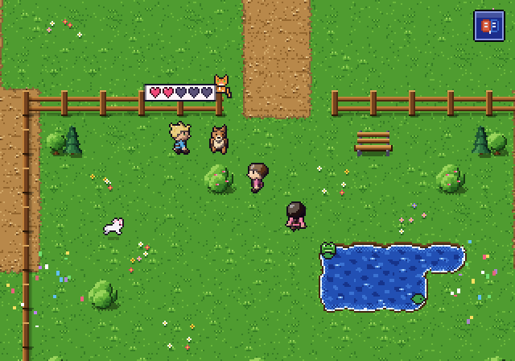

## What a child would get stuck on (before), worst first
1. **Listening games: "who says it?" with nothing that says "tap the cat".** Nico's sound game (chapter 2: *¡Miau!*,
   *¡Guau, guau!*; chapter 6: *¡Cuac!*) ends with a line and a speech bubble over Nico, then the map is free and the
   child is meant to tap the animal. Nothing on screen points anywhere (the hand never comes: it would give the answer
   away). 1 m 30 s lost in chapter 2, **8½ minutes** in chapter 6 (the duck is off screen).
   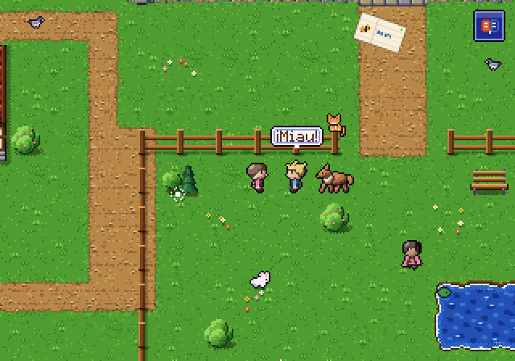 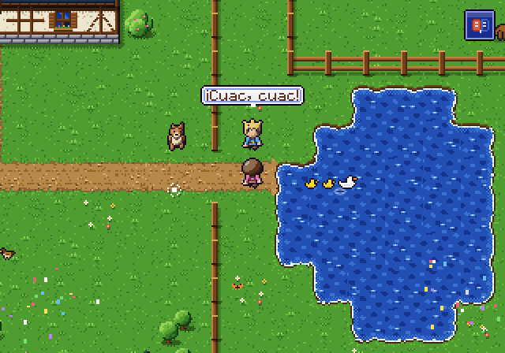
   **Worse:** during *¡Guau, guau!* (tap Canelo) the hand's fallback ("a door that leads to someone with something to
   do") found Canelo listed in the house and sent the child **in and out of the front door 12 times** (5 minutes).
   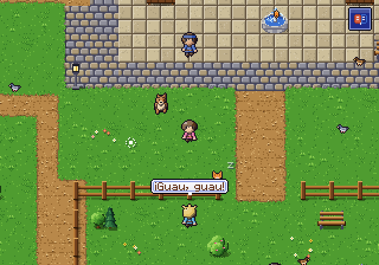 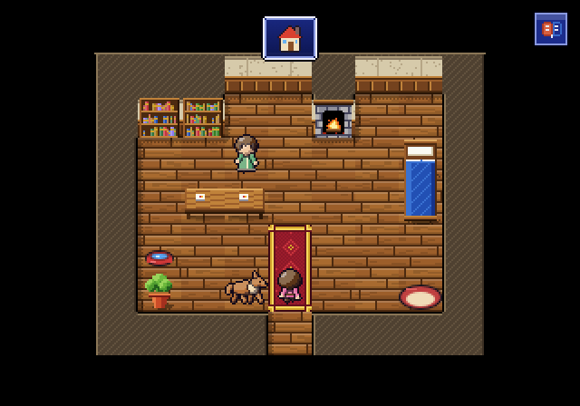
2. **Gaps between chapters: nothing to do at all.** The first time in town (chapter 2 waits a few minutes so no more
   than 5 new words fall in 5 minutes), after chapter 3 (the same), at the end of day 1 (chapter 3 is a morning chapter)
   and day 2 (the day's 6 new words are used up): the town is empty of bubbles. Only Canelo's "?" turns up now and then.
   About 7 minutes over three days. This is "ran out of things to do".
   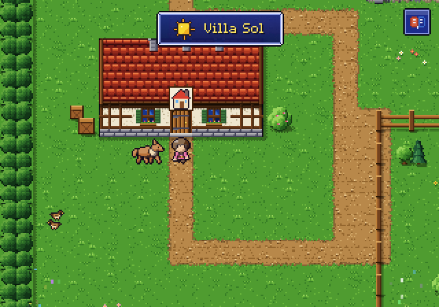 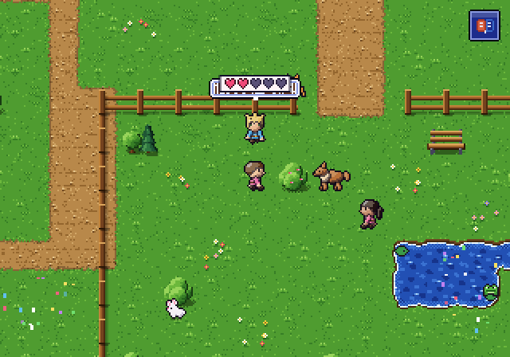
3. **The next person is off screen.** Sofía at the start of day 3 (stuck), Nico at the pond after "¡Los patos... por
   allá!", Marta in the bakery: the only pointer is the hand at the screen's edge, and only after 6 s of standing
   still; a child who wanders never sees it, and it's gone as soon as they move. The arrow-less "!" bubble is
   invisible from where the child stands.
   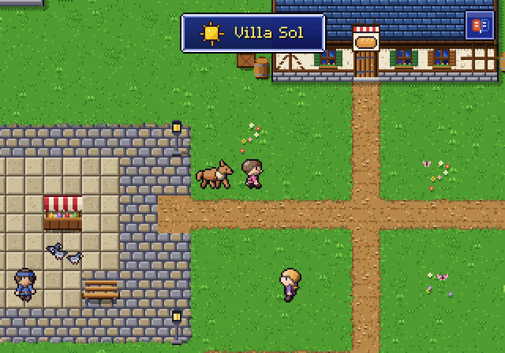
4. **"¿Y mi pelota roja?" (which bush?).** Three balls peek out of three bushes, which a curious child may tap, but
   nothing says "look in these" and the hand never comes (a puzzle's answer). 2 m 20 s, stuck three times.
   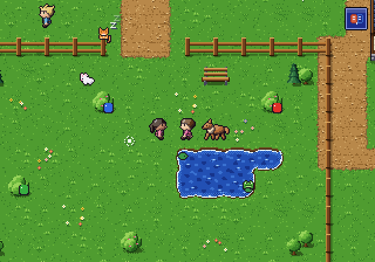
5. **Every other next step waited ~10 s for the hand**: the puppy under the table (a 3-pixel tail), the front door,
   Mamá, the bush with the cat's tail. Fine for a patient child; a wandering one resets the hand's timer with every
   tap. 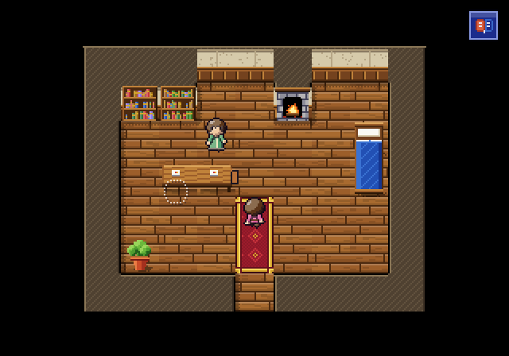
6. **The only overview of "what next" was in a menu**: Misiones, the middle button of the kid's menu, with words under
   the pictures ("Cuaderno", "Misiones", "Animales"). Children don't go there.
   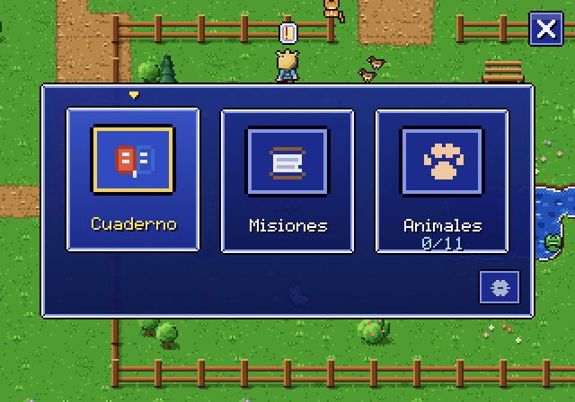 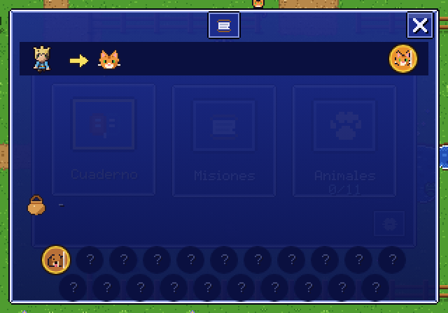

**Instructions that only work if you read (or understand) the Spanish**, each the last line before a lost moment:
*¡Mira! ¡El parque!* (go to the park, Nico is there), *¡Muy bien! Ahora... ¡Don Pepe!* (and the next step is actually
the door and Nico on the way), *Los patos... ¡por allá!* (the ducks are at the pond, east), *¿Y mi pelota roja?* (look
in the bushes), *¡Miau!* / *¡Guau, guau!* / *¡Cuac!* (tap who says it), *¡Hasta mañana!* (come back tomorrow), *¡Esta
noche!*. The questions themselves read fine without Spanish: their cards are pictures, and the right picture can be
worked out.

**Bubbles**: chapter givers mostly showed a bare "!" (Nico, Mamá, Don Pepe, Sofía): it says "someone", not "what".

## What changed (step 1)
- **The guide** (`src/guide.js`). While the child is free to walk there is always **one** goal: the chapter's step (a
  person, a place, an animal, a door, a find-it puzzle; the next chapter's giver; a review day's teacher) > home at
  sunset > a favour > Nico's hide-and-seek > Canelo's "?", Luna's palabra, Inés's pages, a side job, anyone with a
  bubble. It shows without words:
  - on screen, a bouncing yellow arrow over it (over its bubble; under it pointing up near the top of the screen);
  - off screen, an arrow at the screen's edge pointing the way, with a little picture of who or what is there;
  - on another map, the arrow is over the right door in town, or on the way out of a building, with the picture of
    who is waiting beside it;
  - a puzzle's **choices** (the cat and Canelo in the listening game, the three bushes, a find-it's picture bubbles)
    all get a small white arrow, never only the answer, and the hand stays away;
  - standing about for ~4 s, **Canelo trots a few tiles toward it**, barks and looks back; he follows again as soon
    as the child walks;
  - a favour that names a place or an animal only by its word (the word being remembered) gets its arrow only as a
    hint, after ~10 s; hide-and-seek animals likewise (the peeking ears are the game).
  - nothing to do (the next chapter opens tomorrow): no arrow.
- **The hint hand follows the guide's goal** (on screen only; off screen the edge arrow is there all the time): the
  in-and-out door loop is gone.
- **Bubbles**: a chapter's person shows the chapter's picture (Nico a cat, Mamá a sun, Don Pepe an apple, Sofía a ball),
  never a bare "!".
- **The kid's menu** is two pictures and no words: the notebook and the animal album (and the grown-ups' gear).
  **Misiones** moved to the grown-ups menu (*Story progress*).
- **Spanish-only instructions**: every one listed above that sends the child somewhere or asks them to tap something
  now has the arrow (or the choice arrows) on what it means, the moment the line closes. *¡Hasta mañana!* and *¡Esta
  noche!* (come back later) are still only words: they belong to step 2.

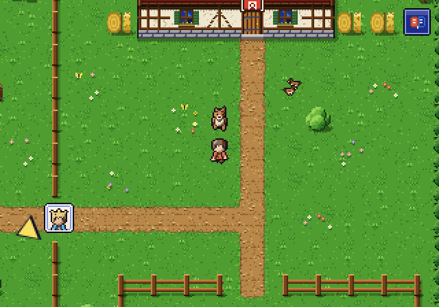 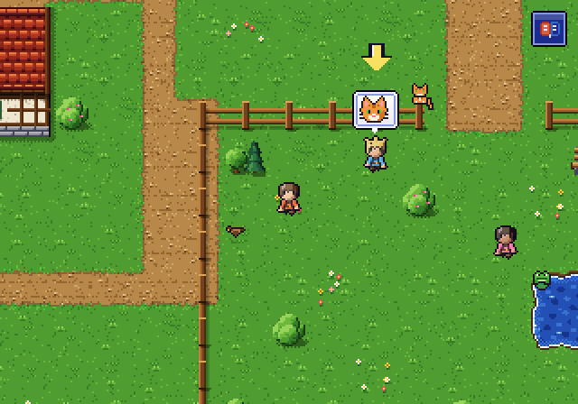
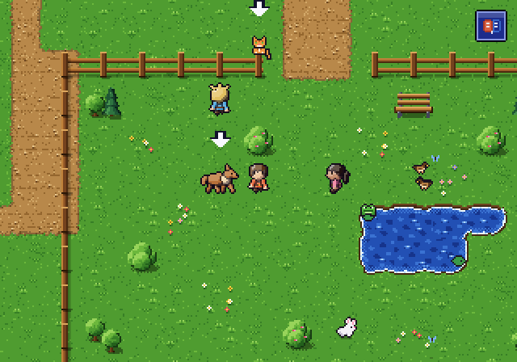 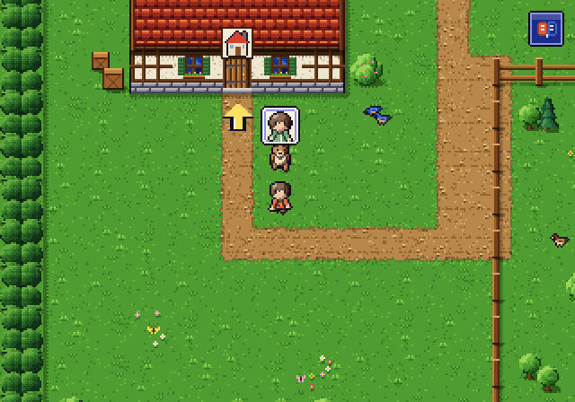
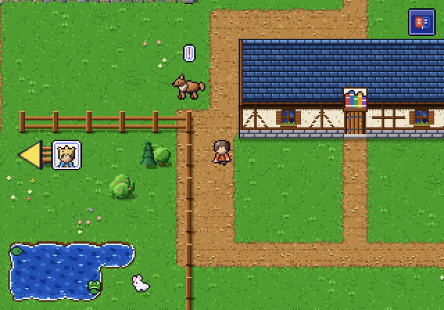 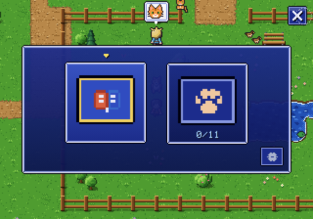

## Step 2: never a dead end, and things to pick up (2026-10-11)
What step 1 left was time with **nothing to do at all**: the gaps between chapters (a chapter that opens a few minutes
later, a morning chapter, today's new words used up) and the end of each day. Step 2 makes sure something fun is always
there, and asks nothing new of the word budget:
- **Pick up and carry** (`src/carry.js`; the child asked for it): apples under two apple trees and in the barn's basket,
  sticks, Canelo's blue ball, his bone every morning, eggs in the barn, flowers, Tomás's lost letter. A tap picks it up;
  it's held up over your head and shown in the corner as picture + word ("?" while unmet: never met this way). Canelo
  fetches the ball and the stick from your hands and eats the bone; a friend who loves it takes it for a heart; anyone
  else holds up the face of who'd love it. Chapter 4's apple for Rosa is now carried to her.
- **The day's play** is the guide's last tier: what you hold goes to whoever would love it today (or Canelo, or the
  ducks); empty-handed, today's next play (fetch, an apple for Luna or Gómez, a flower for Mamá, the bone, a stick, an
  egg for Rosa, bread for the ducks, a page puzzle), and a game of fetch is always there.
- **Waiting you can see**: the next chapter's giver sleeps under a night-blue moon bubble with "z z" floating up (the
  moon alone: tonight) instead of a sun and *¡Mañana!*; tapped, they yawn and hold up the sleeping picture, then the
  sunrise. *¡Hasta mañana!* (Nico, Luna) holds up the sunrise. At sunset the arrow goes home, at home to the bed: a tap
  on it ends the day.

| | step 1 (the guide) | step 2 (never a dead end) |
| --- | --- | --- |
| seconds wandering or standing about **with nothing to do** (no next story step), days 1-3 | **659** | **0** |
| ... of them in daytime (before sunset) | 659 | 0 |
| seconds lost while there was a story step | 14 | 14 |
| moments stuck (45 s and nothing to tap) | 7 | 0 |
| how each day ended | stuck with nothing to do, the bot sent to the next day (the rest of the day empty) | sunset, home, bed, at 18 minutes of play |
| chapters done by the end of day 3 | 1-6 | 1-6 |
| moments free on the map, days 1-3 | 60 | 945 (872 of them the day's play) |

The step-1 run cut every empty gap off after ~40 s and ended each day there, so its 659 s is a floor: a child had the
rest of the day (to sunset at 18 minutes) with nothing. With step 2 the bot played every day to sunset following only
what it saw: 290, 289 and 271 moments a day with no story step, every one of them a play goal, none lost. The 14 s
left are step 1's: on day 3 the guide showed Nico's hide-and-seek (whose arrow waits ~10 s on purpose: the peeking ears
are the game) while bread for the ducks was also in hand.

The day's play the bot followed (moments): fetch 793, throw the stick or the ball 30, an apple (picked, given) 13, an
egg 12, a flower 9, a stick 5, the ball 5, the bone 4, a page puzzle 1. Once a day's dozen plays are done (few words
are met on days 1-3, so few friends' presents), the arrow keeps suggesting a game of fetch: never empty, but samey
(see what remains).

`NODE_PATH=$(npm root -g) node tools/audit-intuitive.js [out dir] --label after2` (the bot sleeps into the next
calendar day, so each day's own new-word limit opens the next chapter as it would for a child coming back tomorrow).

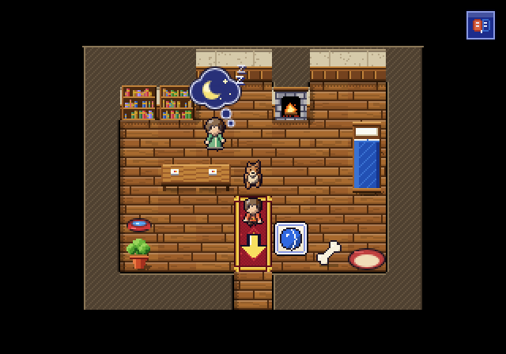 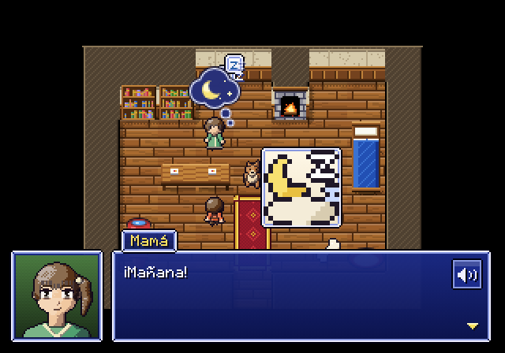
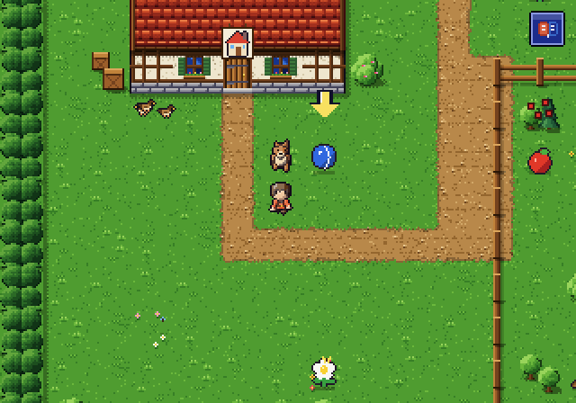 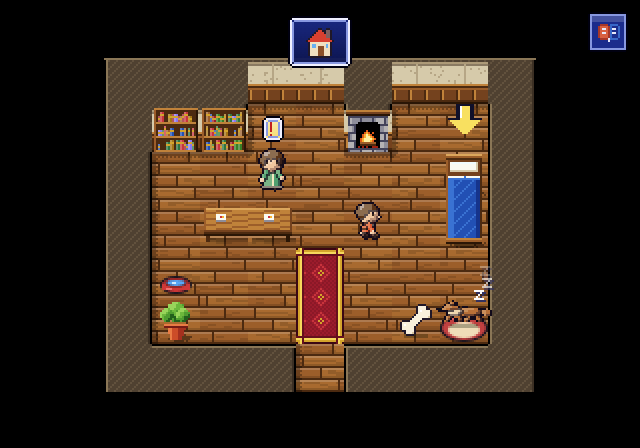
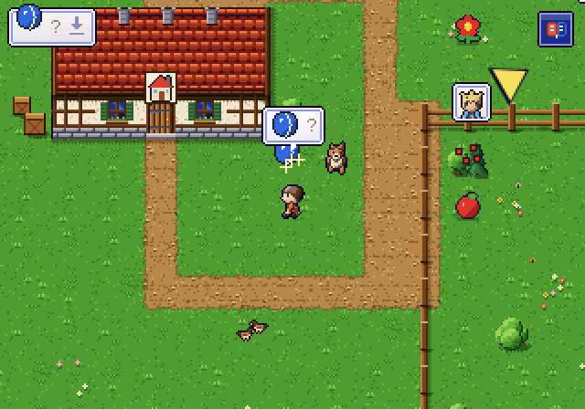 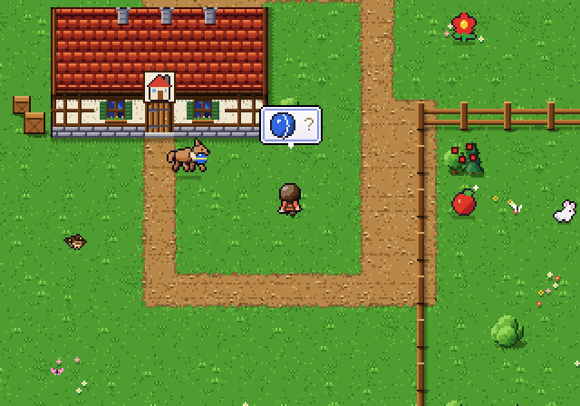
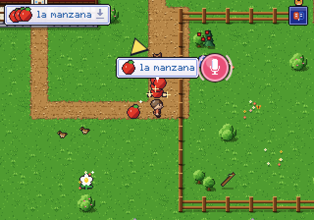 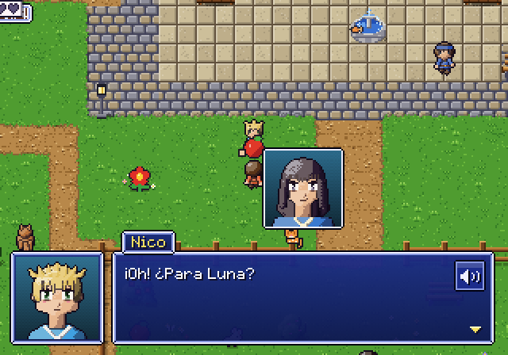

## What remains (the next steps)
- **More kinds of play once the day's list is done** (after step 2): the arrow falls back to fetch; Canelo's tricks
  and care (his menu), petting him, the ducks without bread, more friends' presents as words are met would vary it.
- **Word cards that grow; picture and word always; ghost-hand demos** (step 3): stars mean little to a child; the
  notebook comes too soon; a first-time action (calling Canelo, the say-it mic, putting a thing down by tapping
  yourself, throwing the ball to Canelo) should be shown by a ghost hand doing it once.
- The puppy's tail under the table and the peeking balls are tiny: with the arrow they're found, but they could be
  bigger and livelier.
- The guide shows one goal; a child who wants to wander still can, and the arrow waits. Whether the edge arrow is too
  insistent for a child who is happily exploring is for the next playtest.
